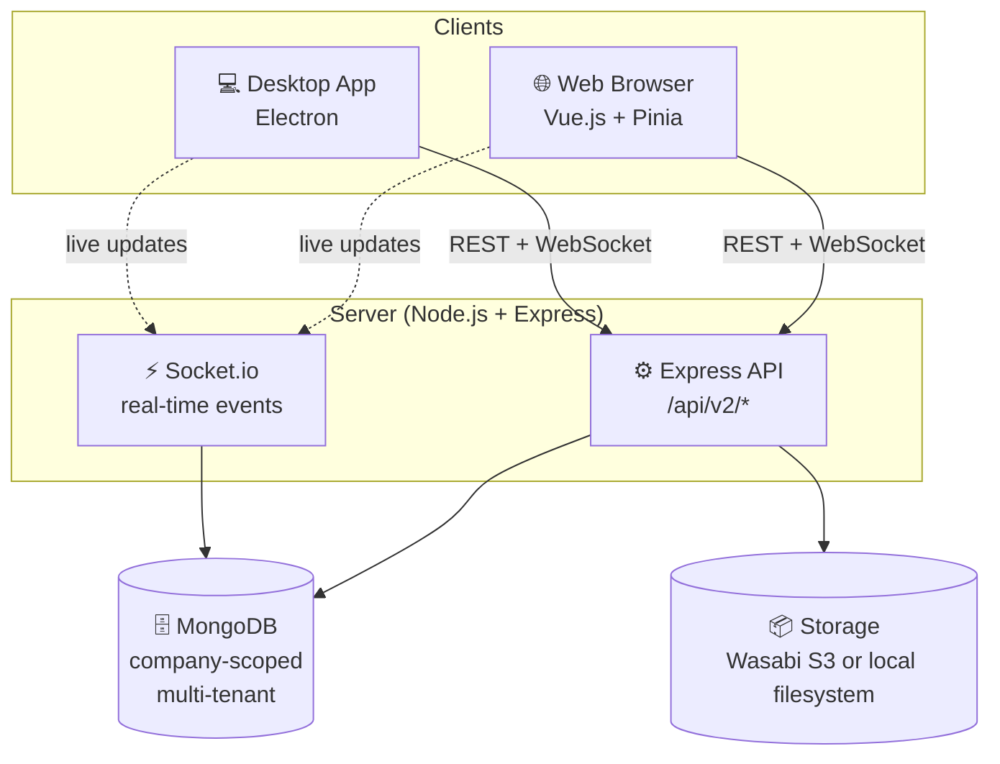
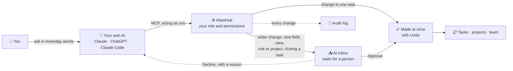

<div align="center">
<a href="https://alianhub.com">
    <strong style="font-size:32px;">AlianHub</strong>
</a>

# AlianHub — Open-Source Project Management Software (Self-Hosted Jira / ClickUp Alternative)

<br/>
<br/>

<div align="center">
    <a href="https://alianhub.com">Website</a> |
    <a href="https://help.alianhub.com">Documentation</a> |
    <a href="./CONTRIBUTING.md">Contributing</a>
</div>
<br/>
<div>
    <a href="https://demo.alianhub.com" target="_blank">
      
    </a>
</div>
</div>

<br/>

<div align="center">
<strong>The open-source, self-hosted project management platform — a ClickUp / Jira alternative with built-in time tracking (screenshots + timesheets) and AI project planning.</strong>
<br/>
<br/>
Built for enterprises, startups, and growing teams — no per-seat pricing, no vendor lock-in, your data on your own servers.
</div>

<br/>

**AlianHub** is free, open-source project management software you host yourself. It brings task management, sprint planning, time tracking with timesheets and optional screenshots, Gantt charts, Kanban boards, docs and automations into one workspace. Each person can connect their own AI assistant (Claude, ChatGPT or Claude Code) over MCP to find, add and update work for them. Teams use it as a self-hosted alternative to Jira, ClickUp, Linear and Monday.com, released under the AGPL-3.0 license and run with Docker on your own servers.

[Live demo](https://demo.alianhub.com) · [Website](https://alianhub.com) · [Documentation](https://help.alianhub.com) · [Self-host with Docker](#option-1--self-hosting-with-docker-recommended) · [FAQ](#faq)

<p align="center">
  <b>Jump to:</b>
  <a href="#features">Features</a> ·
  <a href="#quick-start">Quick Start</a> ·
  <a href="#connect-your-ai-claude-chatgpt-over-mcp">Connect your AI</a> ·
  <a href="#faq">FAQ</a> ·
  <a href="#contributing">Contributing</a>
</p>

<br/>

<div align="center">

[](LICENSE)
[](CODE_OF_CONDUCT.md)
[](https://github.com/aliansoftwareteam/AlianHub-Project-Management-System/releases)
[](https://github.com/aliansoftwareteam/AlianHub-Project-Management-System/discussions)
[](https://github.com/aliansoftwareteam/AlianHub-Project-Management-System/stargazers)

</div>

<br/>

<p align="center">
  <a href="https://demo.alianhub.com" target="_blank">
<picture>
  <source media="(prefers-color-scheme: dark)" srcset="https://raw.githubusercontent.com/aliansoftwareteam/AlianHub-Project-Management-System/main/.gitbook/assets/screenshots/home-dark.png">
  
</picture>
  </a>
</p>

<br/>

---

## Quick Start

**Requirements**

| | |
|---|---|
| Docker | Docker with Compose, for the one-command install. Images are multi-arch (amd64 + arm64). |
| Node.js | 20.x, for installing from source (`engines` in `package.json`). |
| MongoDB | 7 (the Compose file runs `mongo:7`). |

### Option 1 — Self-hosting with Docker (recommended)

```bash
# Grab the compose file and run
curl -O https://raw.githubusercontent.com/aliansoftwareteam/AlianHub-Project-Management-System/main/docker-compose.yml
# Set JWT_SECRET (required) — see .env.example for full env-var reference
echo "JWT_SECRET=$(openssl rand -hex 32)" > .env
docker compose up -d
# AlianHub running at http://localhost:4000
```

<details>
<summary><b>Update to a newer version later</b></summary>

```bash
docker compose pull && docker compose up -d
```

> Images are published to GHCR: `ghcr.io/aliansoftwareteam/alianhub:latest`. Multi-arch (amd64 + arm64).

</details>

<details>
<summary><b>Upgrading and database migrations</b></summary>

Migrations run automatically at boot, before the server starts listening, and each one is recorded in the database. A failed migration does not stop the server: `/health` reports `migrationError` and the next boot retries it. To run them by hand set `MIGRATIONS_AUTO=false` and use `npm run migrate:status`, `npm run migrate -- up --dry-run` and `npm run migrate`. Back up before a major upgrade. **Settings → Instance → Upgrade** shows the running version, the latest release and the migration state. The full walkthrough is in [docs/ADMIN-GUIDE.md](docs/ADMIN-GUIDE.md).

</details>

### Option 2 — Install from source (for developers)

```bash
git clone https://github.com/aliansoftwareteam/AlianHub-Project-Management-System.git
cd AlianHub-Project-Management-System
npm run setup
```

<details>
<summary><b>What <code>npm run setup</code> does, first-run setup and AI defaults</b></summary>

That's it. `npm run setup` will:

1. Install all dependencies (root and frontend) in parallel
2. Generate a `.env` file with secure random secrets
3. Start the server (the same entry production uses)
4. Open `http://localhost:4000` in your browser

On an empty database the app opens its **first-run setup** (`/setup`): create
your own owner account and company, optionally with sample data. Mail, storage,
AI and sign-in providers are configured afterwards from **Settings → Instance**
(product owners only) or through environment variables — see
[docs/ENV.md](docs/ENV.md) for every variable and
[docs/ADMIN-GUIDE.md](docs/ADMIN-GUIDE.md) for the operator walkthrough.

On a new install each person can connect their own AI (Claude, ChatGPT, Claude
Code) out of the box: the MCP tools and sign-in by address are on by default,
and an outside app's risky writes wait for a person. The AI acts only as that
person, with the permissions they grant it. Set `MCP_OAUTH=off`,
`MCP_TOOLS_DATA=off`, `MCP_TOOLS_MANAGE=off` or `MCP_TOOLS_WORK=off` in `.env`,
or switch them under **Settings → Instance → AI**, to turn any of it off. An
upgraded install keeps them off until an owner turns them on there; see
[docs/MCP-AGENT-GUIDE.md](docs/MCP-AGENT-GUIDE.md).

</details>

**Prerequisite:** MongoDB running locally on `mongodb://localhost:27017`. If you don't have it: `docker run -d -p 27017:27017 mongo:7` or download from [mongodb.com](https://www.mongodb.com/try/download/community).

### Available commands

<details>
<summary><b>Show the npm commands</b></summary>

| Command | What it does |
|---------|--------------|
| `npm run setup` | Install deps, prepare `.env`, and start the server |
| `npm run dev` | Same as setup but skips dependency install |
| `npm run setup:reset` | Wipe `node_modules` and reinstall everything |
| `npm run setup -- --no-open` | Start without auto-opening a browser |
| `npm test` / `npm run lint` | Jest (unit + conventions) / ESLint — the CI gate |
| `cd frontend && npm test` | Vitest component specs |

> For active development with hot-reload, run the backend (`npm run nodemon`) and the frontend dev server (`cd frontend && npm run serve`) separately. Developers: [docs/DEVELOPER-GUIDE.md](docs/DEVELOPER-GUIDE.md).

</details>

---

## What is AlianHub?

**AlianHub** is a full-stack, open-source project management system designed for teams that require flexibility, transparency, and ownership over their workflows.

Unlike SaaS-only tools, AlianHub is built to be:
- **Self-hosted**
- **Extensible**
- **Customizable for real-world organizational needs**

It supports both web and desktop environments and is suitable for internal tools, enterprise deployments, and long-term team collaboration.

### Why choose AlianHub over Jira or ClickUp

- **Self-hosted and open source** — run it on your own servers with Docker; the code is AGPL-3.0 and your data stays in your own MongoDB.
- **No per-seat pricing** — add as many people as your server can hold.
- **Time tracking built in** — timers, weekly timesheets with approval, and an optional desktop tracker with screenshots, without a separate add-on.
- **Bring your own AI** — each person connects Claude, ChatGPT or Claude Code over MCP. The AI acts only as that person, every change is logged, and risky changes wait for approval ([how it works](docs/CONNECT-YOUR-AI.md)).
- **Easy to move in** — import tasks, subtasks, comments, checklists and custom fields from a ClickUp export ([guide](docs/MOVING-FROM-CLICKUP.md)).
- **Multi-tenant** — one instance can host several companies, each with isolated data.

---

## Architecture



> **Key principle:** all data is scoped to `companyId` for multi-tenancy. A single AlianHub instance can host multiple companies, each with isolated data.

Deeper architecture docs: [`.claude/ARCHITECTURE.md`](.claude/ARCHITECTURE.md) · [`.claude/DESIGN.md`](.claude/DESIGN.md)

---

## Tech Stack

AlianHub is built using a pragmatic and scalable stack:

- **Frontend**: Vue
- **Backend**: Node.js
- **Database**: MongoDB
- **Desktop**: Electron
- **Repository Structure**: Single repository

---

## What's new in 14.37

- **Agent teams** — ready-made team packs create one agent per role, with starter rules, tags and workflows. A company view shows the roles as an org chart, and a dispatcher can route new tasks to a role, in suggest or apply mode.
- **AI planning** — the Ask box and the project generator plan with the server model, name and set up views, and can add starter automations that start switched off. A workspace can set a daily AI budget.
- **GitHub** — connect GitHub in one click, pick repositories per project, and see pull requests linked to tasks.
- **Connect your own AI** — the MCP tools and sign-in by address are on by default for new installs; upgraded installs keep them off until an owner turns them on.
- **Installable app** — the web app can be installed, and its shell opens offline.

Every release is listed in [CHANGELOG.md](CHANGELOG.md).

---

## Features

### Key features of AlianHub

<table>
  <tr>
    <td width="33%" valign="top">
      📋 <a href="docs/guide/first-hour/03-lists-folders-tasks.md"><b>Projects & tasks</b></a><br/>
      Lists, folders, subtasks, checklists and comments.
    </td>
    <td width="33%" valign="top">
      🗂️ <a href="docs/guide/views.md"><b>Six views</b></a><br/>
      List, Board, Table, Calendar, Gantt and Workload.
    </td>
    <td width="33%" valign="top">
      📊 <a href="docs/guide/views.md#gantt"><b>Gantt chart</b></a><br/>
      Drag bars to reschedule and link blocking tasks.
    </td>
  </tr>
  <tr>
    <td width="33%" valign="top">
      ⏱️ <a href="docs/guide/time.md"><b>Time tracking</b></a><br/>
      Timers, weekly timesheets and approval.
    </td>
    <td width="33%" valign="top">
      👥 <a href="docs/guide/people-and-roles.md"><b>Roles & privacy</b></a><br/>
      Roles, guests, private projects and lists.
    </td>
    <td width="33%" valign="top">
      📝 <a href="docs/guide/docs-and-whiteboards.md"><b>Docs & wiki</b></a><br/>
      Briefs, notes and versions beside the work.
    </td>
  </tr>
  <tr>
    <td width="33%" valign="top">
      ⚙️ <a href="docs/guide/rules.md"><b>Automations</b></a><br/>
      Rules that do a small job when something happens.
    </td>
    <td width="33%" valign="top">
      🧩 <a href="docs/guide/custom-fields.md"><b>Custom fields</b></a><br/>
      Add the details your team tracks to every task.
    </td>
    <td width="33%" valign="top">
      💬 <a href="docs/guide/chat-and-inbox.md"><b>Chat & Inbox</b></a><br/>
      Channels, direct messages, mentions and alerts.
    </td>
  </tr>
  <tr>
    <td width="33%" valign="top">
      🔌 <a href="docs/CONNECT-YOUR-AI.md"><b>Connect your AI</b></a><br/>
      Claude, ChatGPT or Claude Code over MCP.
    </td>
    <td width="33%" valign="top">
      📦 <a href="docs/MOVING-FROM-CLICKUP.md"><b>Import from ClickUp</b></a><br/>
      Bring tasks, comments and custom fields across.
    </td>
    <td width="33%" valign="top">
      🏠 <a href="docs/ADMIN-GUIDE.md"><b>Self-hosted</b></a><br/>
      Run it on your own servers with Docker.
    </td>
  </tr>
</table>

<details>
<summary><b>Full feature list</b></summary>

- **📋 Project & task management** — Create projects with custom milestones, sprints, statuses, and custom fields. Track tasks across **List, Board, Table, Calendar, Gantt, and Workload** views with drag-and-drop, sub-tasks, checklists, attachments, comments, due dates, and reminders.

- **👥 Team collaboration with RBAC** — Assign tasks to users, manage role-based permissions per company, and create custom roles with dynamic permission rules. **Multi-tenant by design** — a single instance can host multiple companies, each with isolated data.

- **⚡ Real-time collaboration via Socket.io** — Changes propagate to every connected client instantly. No polling, no stale views, no `F5` refreshes.

- **🔍 Advanced search & saved filters** — Find tasks by project, status, assignee, creator, due date, or priority. Save frequently used filters for one-click reuse.

- **🏃 Sprint planning** — Plan work in sprints with a backlog, start and complete a sprint, and follow it with burndown, velocity and sprint reports.

- **📊 Gantt chart** — A bar per task from start date to due date. Drag bars to reschedule and draw links to show which task blocks another. Milestones show as diamonds.

- **📝 Docs & wiki** — Write briefs, decisions and meeting notes as docs beside the work, nest pages, comment, keep versions, and share a read-only public link.

- **⚙️ Automations** — Rules that do a small job when something happens, for example "when a task is marked done, tell the project lead". See [rules](docs/guide/rules.md).

- **⏱️ Timesheets & reporting** — Project, user, and workload timesheets. Generate milestone and performance reports. Optional productivity tracking (screenshots / keystrokes / mouse events) for time-sensitive teams.

- **🤖 AI assistance** — Generate tasks, subtasks, checklists, descriptions, and project templates with AI. Multiple LLM providers supported.

- **🔌 AI agents over MCP** — Connect your own Claude, ChatGPT or Claude Code to AlianHub. It works as you, sees only what you can open, and changes that need approval wait for a person. See [Connect your AI](docs/CONNECT-YOUR-AI.md) and the [MCP agent guide](docs/MCP-AGENT-GUIDE.md).

- **💬 Built-in chat & channels** — Real-time messaging and dedicated channels per project or team.

- **💻 Web + desktop (Electron)** — Identical experience in the browser and as a native desktop app. **Fourteen UI languages** via vue-i18n: English, Arabic, Chinese, French, German, Greek, Gujarati, Hindi, Italian, Japanese, Korean, Portuguese (Brazil), Russian and Spanish.

- **🏠 Self-hosted, your data** — Run on your own servers with MongoDB and Wasabi/S3 (or local filesystem) storage. **No vendor lock-in, no per-seat pricing, no data leaving your infrastructure.**

</details>

> Features evolve continuously — see [Discussions](https://github.com/aliansoftwareteam/AlianHub-Project-Management-System/discussions) for what's next and [CHANGELOG.md](CHANGELOG.md) for what just shipped.

---

## Feature status

| Capability | Status |
|---|---|
| List · Board (Kanban) · Table · Calendar · Gantt · Workload views | ✅ Shipped |
| Sub-tasks, checklists, attachments, comments, custom fields | ✅ Shipped |
| Time tracking — timesheets + optional screenshots / activity | ✅ Shipped |
| Custom roles & per-company RBAC | ✅ Shipped |
| Sprints, milestones & reports | ✅ Shipped |
| AI task / sub-task / project generation | ✅ Shipped |
| Built-in chat & channels · real-time sync (Socket.io) | ✅ Shipped |
| Docs & wiki pages · automations (rules) | ✅ Shipped |
| Connect your own AI (Claude, ChatGPT) over MCP | ✅ Shipped |
| Import from ClickUp | ✅ Shipped |

---

## How AlianHub compares

Capabilities that are **free and built-in** here — but paid, limited, or absent in other open-source PM tools:

| Capability | AlianHub | Plane (open-source) |
|---|---|---|
| Time tracking with screenshots | ✅ Free | ❌ Not available |
| Custom fields | ✅ Free | 💲 Paid |
| Custom roles & permission matrix | ✅ Free | ❌ 3 fixed roles |
| Dashboards & widgets | ✅ Free | 💲 Paid (custom) |
| Built-in chat | ✅ Free | ❌ Not available |
| AI project generation | ✅ Free (your API key) | ❌ Not available |
| Milestones | ✅ Free | ❌ Not available |

> Comparison reflects each project's open-source edition; both are AGPL-3.0. AlianHub is younger and still closing gaps of its own — see [Discussions](https://github.com/aliansoftwareteam/AlianHub-Project-Management-System/discussions) for what's next.

---

## 📸 Screenshots

A quick tour of AlianHub. [Try the live demo](https://demo.alianhub.com) to explore for yourself.

<details>
<summary><b>Screenshot gallery (light and dark)</b></summary>

<p>Your browser picks the light or dark version. The workspace shown is made-up demo data.</p>

<h4>Home</h4>

<p align="center">
<picture>
  <source media="(prefers-color-scheme: dark)" srcset="https://raw.githubusercontent.com/aliansoftwareteam/AlianHub-Project-Management-System/main/.gitbook/assets/screenshots/home-dark.png">
  
</picture>
</p>

<h4>List view</h4>

<p align="center">
<picture>
  <source media="(prefers-color-scheme: dark)" srcset="https://raw.githubusercontent.com/aliansoftwareteam/AlianHub-Project-Management-System/main/.gitbook/assets/screenshots/list-dark.png">
  
</picture>
</p>

<h4>Board view</h4>

<p align="center">
<picture>
  <source media="(prefers-color-scheme: dark)" srcset="https://raw.githubusercontent.com/aliansoftwareteam/AlianHub-Project-Management-System/main/.gitbook/assets/screenshots/board-dark.png">
  
</picture>
</p>

<h4>Gantt chart</h4>

<p align="center">
<picture>
  <source media="(prefers-color-scheme: dark)" srcset="https://raw.githubusercontent.com/aliansoftwareteam/AlianHub-Project-Management-System/main/.gitbook/assets/screenshots/gantt-dark.png">
  
</picture>
</p>

<h4>Task detail</h4>

<p align="center">
<picture>
  <source media="(prefers-color-scheme: dark)" srcset="https://raw.githubusercontent.com/aliansoftwareteam/AlianHub-Project-Management-System/main/.gitbook/assets/screenshots/task-detail-dark.png">
  
</picture>
</p>

<h4>Dashboard</h4>

<p align="center">
<picture>
  <source media="(prefers-color-scheme: dark)" srcset="https://raw.githubusercontent.com/aliansoftwareteam/AlianHub-Project-Management-System/main/.gitbook/assets/screenshots/dashboard-dark.png">
  
</picture>
</p>

<h4>Time tracking</h4>

<p align="center">
<picture>
  <source media="(prefers-color-scheme: dark)" srcset="https://raw.githubusercontent.com/aliansoftwareteam/AlianHub-Project-Management-System/main/.gitbook/assets/screenshots/time-tracking-dark.png">
  
</picture>
</p>

<h4>Docs</h4>

<p align="center">
<picture>
  <source media="(prefers-color-scheme: dark)" srcset="https://raw.githubusercontent.com/aliansoftwareteam/AlianHub-Project-Management-System/main/.gitbook/assets/screenshots/docs-dark.png">
  
</picture>
</p>

<h4>AI Inbox</h4>

<p align="center">
<picture>
  <source media="(prefers-color-scheme: dark)" srcset="https://raw.githubusercontent.com/aliansoftwareteam/AlianHub-Project-Management-System/main/.gitbook/assets/screenshots/ai-inbox-dark.png">
  
</picture>
</p>

<h4>AI agents</h4>

<p align="center">
<picture>
  <source media="(prefers-color-scheme: dark)" srcset="https://raw.githubusercontent.com/aliansoftwareteam/AlianHub-Project-Management-System/main/.gitbook/assets/screenshots/ai-agents-dark.png">
  
</picture>
</p>

</details>


### Dashboard

<p align="center">
  <a href="https://demo.alianhub.com" target="_blank">
    
  </a>
</p>

<p align="center">
  <em>Customizable home dashboard with drag-to-arrange widgets — Task by Assignee, Workload by Status, and a live Calendar view.</em>
</p>

### Board View (Kanban)

<p align="center">
  <a href="https://demo.alianhub.com" target="_blank">
    
  </a>
</p>

<p align="center">
  <em>Drag-and-drop Kanban board grouped by status (or any field). Cards show due date, assignee, priority, and sub-task count. Switch the same project to <strong>List, Table, Calendar, Workload</strong>, or a custom view at any time.</em>
</p>

### List View

<p align="center">
  <a href="https://demo.alianhub.com" target="_blank">
    
  </a>
</p>

<p align="center">
  <em>Dense list view grouped by status with sortable columns — Chat, Assignee, Due Date, Priority, Key, Created Date, Created By. Select one or many tasks to bulk-edit status, priority, assignees, due dates, tags, or delete/archive in a single click.</em>
</p>

### Calendar View

<p align="center">
  <a href="https://demo.alianhub.com" target="_blank">
    
  </a>
</p>

<p align="center">
  <em>Monthly calendar with tasks rendered as color-coded bars spanning their start and due dates. Sub-tasks appear inline with their parent. Filter by yourself or any assignee, navigate month-to-month, or jump to today.</em>
</p>

### Task Detail

<p align="center">
  <a href="https://demo.alianhub.com" target="_blank">
    
  </a>
</p>

<p align="center">
  <em>Full task editor with <strong>Task Details, Comments, Activity Log, and Time Log</strong> tabs. Add sub-tasks, define unlimited custom fields (text, number, email, checkbox, currency, etc.), attach files, and track estimated vs. actual hours in the always-visible right sidebar.</em>
</p>

### Workload Report

<p align="center">
  <a href="https://demo.alianhub.com" target="_blank">
    
  </a>
</p>

<p align="center">
  <em>Weekly <strong>workload + timesheet</strong> in a single view — see logged vs. planned hours per user, drill down into projects and individual tasks, navigate any date range, and toggle between automatically tracked time and manual entries. A capacity-planning differentiator that most open-source PMS tools don't ship.</em>
</p>

### Settings & Customization

<p align="center">
  <a href="https://demo.alianhub.com" target="_blank">
    
  </a>
</p>

<p align="center">
  <em>Deep, per-company customization — company info, <strong>custom task priorities with icons</strong>, milestone statuses with past/future calendar visibility, multi-currency support, members & teams, project templates, custom field manager, role-based security &amp; permissions, time-tracking rules, and notification preferences.</em>
</p>

### AI Assist

<p align="center">
  <a href="https://demo.alianhub.com" target="_blank">
    
  </a>
</p>

<p align="center">
  <em>AI available everywhere — generate tasks, sub-tasks, checklists, project plans, and task descriptions from natural language. Pre-built prompt templates across <strong>Marketing, Sales, Email, SEO, and Services</strong> to jump-start your work without staring at a blank field.</em>
</p>

<!-- More screenshots added here as new modules are captured -->

---

## Documentation

📘 **Full user guide & API reference:** [help.alianhub.com](https://help.alianhub.com)

New to project tools? [docs/guide/first-hour/](docs/guide/first-hour/README.md) walks through your first hour, one short page at a time.

Going deeper? [docs/guide/](docs/guide/README.md) is the guide's index. It links [views, filters and saved views](docs/guide/views.md), [custom fields](docs/guide/custom-fields.md) and [rules](docs/guide/rules.md).

Coming from ClickUp? [docs/MOVING-FROM-CLICKUP.md](docs/MOVING-FROM-CLICKUP.md) says what to export, what comes across and what does not.

Using Claude or ChatGPT with AlianHub? [docs/guide/agents/](docs/guide/agents/README.md) says how to connect it, what it can do, what waits for your approval, how to undo a change and how to pause it.

For development:

- 🛠️ [docs/DEVELOPER-GUIDE.md](docs/DEVELOPER-GUIDE.md) — set up, architecture and how to change things
- 🏠 [docs/ADMIN-GUIDE.md](docs/ADMIN-GUIDE.md) — run, back up and upgrade your own instance
- 🤝 [CONTRIBUTING.md](CONTRIBUTING.md) — how to contribute
- 🌿 [BRANCHING.md](BRANCHING.md) — branching strategy and PR workflow
- 🛡️ [CODE_OF_CONDUCT.md](CODE_OF_CONDUCT.md) — community standards
- 🔒 [SECURITY.md](SECURITY.md) — responsible disclosure for security issues
- ♿ [docs/ACCESSIBILITY.md](docs/ACCESSIBILITY.md) — accessibility statement, known gaps and how to report a problem
- 🆘 [SUPPORT.md](SUPPORT.md) — where to ask questions, report bugs, request features

---

## Connect your AI (Claude, ChatGPT) over MCP

AlianHub ships an MCP server, so the AI app you already use can work inside your workspace. Open **AI → Connect your AI** in AlianHub, copy the address, and add it as a custom connector in Claude or ChatGPT (or in Claude Code). After that you can ask in everyday words to find tasks, add tasks and subtasks, comment, log time or change a status.

- It works as you: it sees only what you can open and changes only what your role allows.
- Every change is written in the audit log, and risky changes wait for a person to approve them.
- It cannot delete tasks, docs, comments or projects, and cannot change who may do what.



Step-by-step guide: [docs/CONNECT-YOUR-AI.md](docs/CONNECT-YOUR-AI.md) · every tool: [docs/MCP-AGENT-GUIDE.md](docs/MCP-AGENT-GUIDE.md).

---

## Demo

You can explore a live demo here:

👉 **https://demo.alianhub.com**

> Demo data may reset periodically.

---

## Roadmap

What we're working on, what's planned, and what we're considering — follow along in [GitHub Discussions](https://github.com/aliansoftwareteam/AlianHub-Project-Management-System/discussions).

Want to suggest something? [Open a feature request](https://github.com/aliansoftwareteam/AlianHub-Project-Management-System/issues/new?template=feature_request.yml) or [start a discussion](https://github.com/aliansoftwareteam/AlianHub-Project-Management-System/discussions).

---

## Contributing

Contributions are welcome — bug reports, feature ideas, documentation fixes, and pull requests of all sizes.

📖 **Start here:**

- 🤝 [CONTRIBUTING.md](CONTRIBUTING.md) — how to submit issues and PRs
- 🌿 [BRANCHING.md](BRANCHING.md) — branch model and PR workflow
- 🛡️ [CODE_OF_CONDUCT.md](CODE_OF_CONDUCT.md) — community standards
- 🔒 [SECURITY.md](SECURITY.md) — responsible disclosure for security issues

Looking for something to work on? Browse [good first issues](https://github.com/aliansoftwareteam/AlianHub-Project-Management-System/issues?q=is%3Aissue+is%3Aopen+label%3A%22good+first+issue%22) or [help wanted](https://github.com/aliansoftwareteam/AlianHub-Project-Management-System/issues?q=is%3Aissue+is%3Aopen+label%3A%22help+wanted%22).

---

## Support & Community

| What | Where |
|---|---|
| 📘 **Read the docs** | [help.alianhub.com](https://help.alianhub.com) |
| 💬 **Ask a question** | [GitHub Discussions](https://github.com/aliansoftwareteam/AlianHub-Project-Management-System/discussions) |
| 🐛 **Report a bug** | [Bug Report issue](https://github.com/aliansoftwareteam/AlianHub-Project-Management-System/issues/new?template=bug_report.yml) |
| 🚀 **Request a feature** | [Feature Request issue](https://github.com/aliansoftwareteam/AlianHub-Project-Management-System/issues/new?template=feature_request.yml) |
| 🏢 **Commercial support** | [support@aliansoftware.net](mailto:support@aliansoftware.net) |

Full guide: [SUPPORT.md](SUPPORT.md).

---

## Deploy & customize with Aliansoftware

AlianHub is built and maintained by [Aliansoftware](https://aliansoftware.net). Want it run for you? We also **deploy, customize, and support** AlianHub for teams:

- 🚀 **Managed hosting & deployment** — on your infrastructure or ours
- 🛠️ **Custom features & integrations** — tailored to your workflow
- 🤝 **Priority support & response-time targets** — [support@aliansoftware.net](mailto:support@aliansoftware.net)

---

## Governance

AlianHub is currently maintained by **core maintainers (company-backed)**.

The long-term goal is to transition toward a **community-driven project with dedicated maintainers**.

---

## Security

If you discover a security vulnerability, **do not open a public issue**.

Please report it responsibly using GitHub Security Advisories as described in  
[`SECURITY.md`](SECURITY.md).

---

## Contributors ♥️ Thanks

We extend our gratitude to all our numerous contributors who create plugins, assist with issues and pull requests, and respond to questions on GitHub Discussions.

AlianHub Project-Management-System is a community-driven project, and your contributions continually improve it.

<br/>

<a href="https://github.com/aliansoftwareteam/AlianHub-Project-Management-System/graphs/contributors">
  
</a>

---

## Repo Activity

[](https://github.com/aliansoftwareteam/AlianHub-Project-Management-System/pulse)
[](https://github.com/aliansoftwareteam/AlianHub-Project-Management-System/commits)
[](https://github.com/aliansoftwareteam/AlianHub-Project-Management-System/pulls?q=is%3Apr+is%3Aclosed)
[](https://github.com/aliansoftwareteam/AlianHub-Project-Management-System/issues)

<!--
  To replace the badges above with a richer sparkline embed (like
  Plane's https://repobeats.axiom.co/api/embed/<hash>.svg), sign up
  at https://repobeats.axiom.co with this repo and paste the
  generated URL here.
-->

---

## FAQ

<details>
<summary><h3>Is AlianHub free?</h3></summary>

Yes. AlianHub is free and open source under the AGPL-3.0 license. You can self-host it with no per-seat pricing. Paid help with hosting, customization and support is available from [Aliansoftware](#deploy--customize-with-aliansoftware) if you want it.

</details>

<details>
<summary><h3>Can I self-host AlianHub?</h3></summary>

Yes, that is how it is meant to run. Use the [Docker Compose file](#option-1--self-hosting-with-docker-recommended) (images on GHCR for amd64 and arm64) or [install from source](#option-2--install-from-source-for-developers) with Node.js and MongoDB. See [docs/ADMIN-GUIDE.md](docs/ADMIN-GUIDE.md) and [docs/ENV.md](docs/ENV.md).

</details>

<details>
<summary><h3>How does AlianHub compare to Jira or ClickUp?</h3></summary>

AlianHub covers the everyday project work — tasks, sprints, Board, List, Calendar, Gantt and Workload views, docs, automations and time tracking — but runs on your own servers under an open-source license. See [Why choose AlianHub over Jira or ClickUp](#why-choose-alianhub-over-jira-or-clickup) and the [feature status](#feature-status) table.

</details>

<details>
<summary><h3>Can I move from ClickUp to AlianHub?</h3></summary>

Yes. Export from ClickUp as CSV or Excel and import it under **Settings → Import & export**. Tasks, subtasks, statuses, assignees, dates, tags, checklists, comments and custom fields come across, and the import can be undone. [docs/MOVING-FROM-CLICKUP.md](docs/MOVING-FROM-CLICKUP.md) lists what comes across and what does not.

</details>

<details>
<summary><h3>What AI features does AlianHub have?</h3></summary>

AI Assist generates tasks, subtasks, checklists, descriptions and sprint plans from plain language, using your own LLM API key. Each person can also connect Claude, ChatGPT or Claude Code over MCP to work in AlianHub for them — see [Connect your AI](#connect-your-ai-claude-chatgpt-over-mcp).

</details>

<details>
<summary><h3>What license is AlianHub under?</h3></summary>

The GNU Affero General Public License v3.0 (AGPL-3.0). You can use, modify and self-host it freely; if you run a modified version as a public network service you must publish your changes. See [License](#license).

</details>

<details>
<summary><h3>Does AlianHub have time tracking?</h3></summary>

Yes. Start a timer on a task or add time by hand, send in a weekly timesheet for approval, and optionally use the desktop tracker for screenshots and activity. See [docs/guide/time.md](docs/guide/time.md).

</details>

---

## License

Licensed under the **GNU Affero General Public License v3.0 (AGPL-3.0)**.

See the [LICENSE](LICENSE) file for the full license text and [COPYRIGHT](COPYRIGHT) for the copyright notice.

> **What AGPL-3.0 means for you:**
> - ✅ You can use, modify, self-host, and distribute AlianHub freely.
> - ✅ You can run a private modified version internally without publishing changes.
> - ⚠️ If you run a **modified** version as a **public network service** (SaaS), you must publish your modifications under the same license.
> - 📩 Need a different license for commercial / closed-source use? Contact us at [support@aliansoftware.net](mailto:support@aliansoftware.net).
