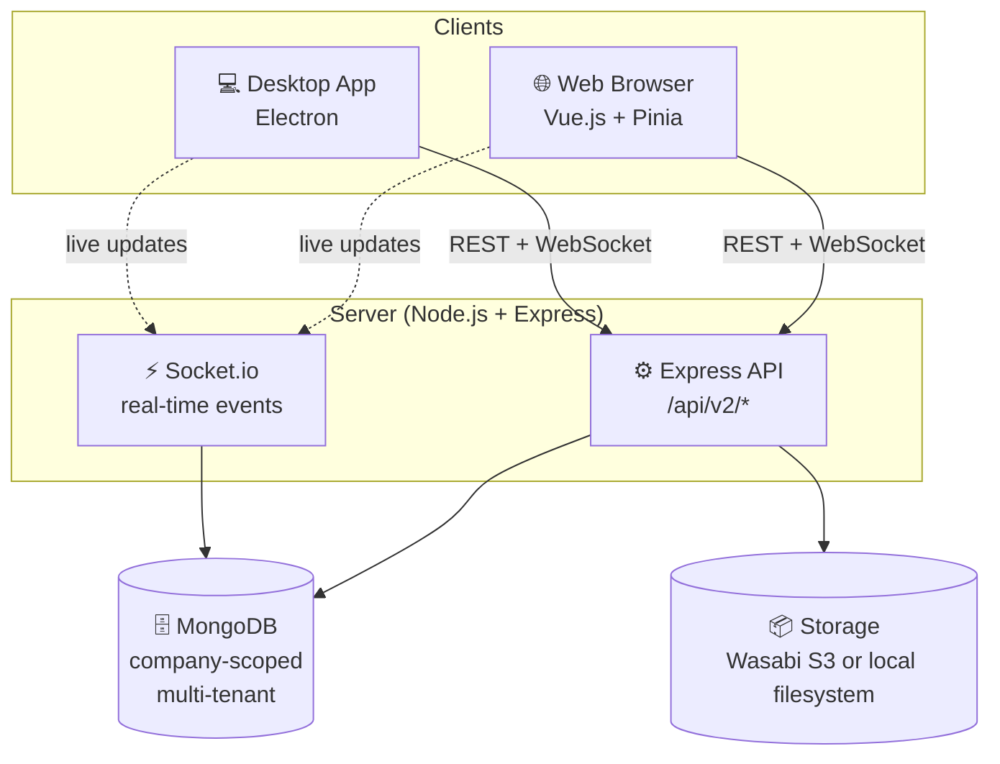
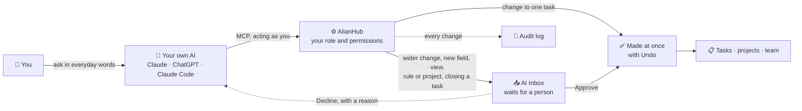

<p align="center">
  <a href="https://alianhub.com">
    <picture>
      <source media="(prefers-color-scheme: dark)" srcset=".gitbook/assets/logo-dark.svg">
      
    </picture>
  </a>
</p>

<h1 align="center">Open-source project management<br/><sub>your team and your AI run together</sub></h1>

<p align="center">
  The self-hosted Jira / ClickUp alternative with sprints, Gantt, Kanban, time tracking and AI agents over MCP.
</p>

<p align="center">
  <a href="https://demo.alianhub.com"></a>
  <a href="https://help.alianhub.com"></a>
  <a href="#self-host-in-1-minute"></a>
  <a href="https://github.com/aliansoftwareteam/AlianHub-Project-Management-System/stargazers"></a>
</p>

<p align="center">
  <a href="https://demo.alianhub.com">
    <picture>
      <source media="(prefers-color-scheme: dark)" srcset="https://raw.githubusercontent.com/aliansoftwareteam/AlianHub-Project-Management-System/main/.gitbook/assets/screenshots/home-dark.png">
      
    </picture>
  </a>
</p>

**AlianHub** is free, open-source project management software you host yourself. It brings task management, sprint planning, time tracking with timesheets and optional screenshots, Gantt charts, Kanban boards, docs and automations into one workspace. Each person can connect their own AI assistant (Claude, ChatGPT or Claude Code) over MCP to find, add and update work for them. Teams use it as a self-hosted alternative to Jira, ClickUp, Linear and Monday.com, released under the AGPL-3.0 license and run with Docker on your own servers. Built for enterprises, startups and growing teams — no per-seat pricing, no vendor lock-in, your data on your own servers.

<table>
  <tr>
    <td width="33%" valign="top">
      📋 <a href="docs/guide/first-hour/03-lists-folders-tasks.md"><b>Tasks & sprints</b></a><br/>
      Lists, subtasks, sprints with burndown, and six views.
    </td>
    <td width="33%" valign="top">
      🤖 <a href="docs/CONNECT-YOUR-AI.md"><b>AI agents</b></a><br/>
      Your own Claude or ChatGPT over MCP; risky changes wait for approval.
    </td>
    <td width="33%" valign="top">
      ⏱️ <a href="docs/guide/time.md"><b>Time tracking</b></a><br/>
      Timers, weekly timesheets with approval, optional screenshots.
    </td>
  </tr>
  <tr>
    <td width="33%" valign="top">
      📊 <a href="docs/guide/views.md"><b>Dashboards & reports</b></a><br/>
      Widgets, milestone, sprint and performance reports.
    </td>
    <td width="33%" valign="top">
      📝 <a href="docs/guide/docs-and-whiteboards.md"><b>Docs & wiki</b></a><br/>
      Briefs, notes and versions beside the work.
    </td>
    <td width="33%" valign="top">
      🔒 <a href="docs/ADMIN-GUIDE.md"><b>Self-hosted & open source</b></a><br/>
      Docker on your servers, AGPL-3.0, your data.
    </td>
  </tr>
</table>

<table>
  <tr>
    <td width="33%" align="center">
      <picture>
        <source media="(prefers-color-scheme: dark)" srcset="https://raw.githubusercontent.com/aliansoftwareteam/AlianHub-Project-Management-System/main/.gitbook/assets/screenshots/board-dark.png">
        
      </picture>
      <br/><sub><b>Kanban board by status</b></sub>
    </td>
    <td width="33%" align="center">
      <picture>
        <source media="(prefers-color-scheme: dark)" srcset="https://raw.githubusercontent.com/aliansoftwareteam/AlianHub-Project-Management-System/main/.gitbook/assets/screenshots/gantt-dark.png">
        
      </picture>
      <br/><sub><b>Gantt chart with dependencies</b></sub>
    </td>
    <td width="33%" align="center">
      <picture>
        <source media="(prefers-color-scheme: dark)" srcset="https://raw.githubusercontent.com/aliansoftwareteam/AlianHub-Project-Management-System/main/.gitbook/assets/screenshots/ai-inbox-dark.png">
        
      </picture>
      <br/><sub><b>AI Inbox for approvals</b></sub>
    </td>
  </tr>
</table>

<details>
<summary><b>More screenshots</b> — list, task detail, dashboard, calendar, workload, time tracking, docs, AI agents, AI Ask, settings</summary>
<br/>

Your browser picks the light or dark version. The workspace shown is made-up demo data. [Try the live demo](https://demo.alianhub.com) to explore for yourself.

<h4>List view</h4>
<picture>
  <source media="(prefers-color-scheme: dark)" srcset="https://raw.githubusercontent.com/aliansoftwareteam/AlianHub-Project-Management-System/main/.gitbook/assets/screenshots/list-dark.png">
  
</picture>

<h4>Task detail</h4>
<picture>
  <source media="(prefers-color-scheme: dark)" srcset="https://raw.githubusercontent.com/aliansoftwareteam/AlianHub-Project-Management-System/main/.gitbook/assets/screenshots/task-detail-dark.png">
  
</picture>

<h4>Dashboard</h4>
<picture>
  <source media="(prefers-color-scheme: dark)" srcset="https://raw.githubusercontent.com/aliansoftwareteam/AlianHub-Project-Management-System/main/.gitbook/assets/screenshots/dashboard-dark.png">
  
</picture>

<h4>Calendar view</h4>
<picture>
  <source media="(prefers-color-scheme: dark)" srcset="https://raw.githubusercontent.com/aliansoftwareteam/AlianHub-Project-Management-System/main/.gitbook/assets/screenshots/calendar-dark.png">
  
</picture>

<h4>Workload</h4>
<picture>
  <source media="(prefers-color-scheme: dark)" srcset="https://raw.githubusercontent.com/aliansoftwareteam/AlianHub-Project-Management-System/main/.gitbook/assets/screenshots/workload-dark.png">
  
</picture>

<h4>Time tracking</h4>
<picture>
  <source media="(prefers-color-scheme: dark)" srcset="https://raw.githubusercontent.com/aliansoftwareteam/AlianHub-Project-Management-System/main/.gitbook/assets/screenshots/time-tracking-dark.png">
  
</picture>

<h4>Docs</h4>
<picture>
  <source media="(prefers-color-scheme: dark)" srcset="https://raw.githubusercontent.com/aliansoftwareteam/AlianHub-Project-Management-System/main/.gitbook/assets/screenshots/docs-dark.png">
  
</picture>

<h4>AI agents</h4>
<picture>
  <source media="(prefers-color-scheme: dark)" srcset="https://raw.githubusercontent.com/aliansoftwareteam/AlianHub-Project-Management-System/main/.gitbook/assets/screenshots/ai-agents-dark.png">
  
</picture>

<h4>AI Ask</h4>
<picture>
  <source media="(prefers-color-scheme: dark)" srcset="https://raw.githubusercontent.com/aliansoftwareteam/AlianHub-Project-Management-System/main/.gitbook/assets/screenshots/ai-ask-dark.png">
  
</picture>

<h4>Settings</h4>
<picture>
  <source media="(prefers-color-scheme: dark)" srcset="https://raw.githubusercontent.com/aliansoftwareteam/AlianHub-Project-Management-System/main/.gitbook/assets/screenshots/settings-dark.png">
  
</picture>

</details>

<details>
<summary><b>All features</b> — views, automations, custom fields, chat, roles, ClickUp import and more</summary>
<br/>

- **📋 Project & task management** — Create projects with custom milestones, sprints, statuses, and custom fields. Track tasks across **List, Board, Table, Calendar, Gantt, and Workload** views with drag-and-drop, sub-tasks, checklists, attachments, comments, due dates, and reminders. See [views, filters and saved views](docs/guide/views.md).
- **👥 Team collaboration with RBAC** — Assign tasks to users, manage role-based permissions per company, and create custom roles with dynamic permission rules. Roles, guests, private projects and lists ([people and roles](docs/guide/people-and-roles.md)). **Multi-tenant by design** — a single instance can host multiple companies, each with isolated data.
- **⚡ Real-time collaboration via Socket.io** — Changes propagate to every connected client instantly. No polling, no stale views, no `F5` refreshes.
- **🔍 Advanced search & saved filters** — Find tasks by project, status, assignee, creator, due date, or priority. Save frequently used filters for one-click reuse.
- **🏃 Sprint planning** — Plan work in sprints with a backlog, start and complete a sprint, and follow it with burndown, velocity and sprint reports.
- **📊 Gantt chart** — A bar per task from start date to due date. Drag bars to reschedule and draw links to show which task blocks another. Milestones show as diamonds ([Gantt guide](docs/guide/views.md#gantt)).
- **📝 Docs & wiki** — Write briefs, decisions and meeting notes as docs beside the work, nest pages, comment, keep versions, and share a read-only public link.
- **⚙️ Automations** — Rules that do a small job when something happens, for example "when a task is marked done, tell the project lead". See [rules](docs/guide/rules.md).
- **🧩 Custom fields** — Add the details your team tracks to every task ([custom fields](docs/guide/custom-fields.md)).
- **⏱️ Timesheets & reporting** — Project, user, and workload timesheets. Generate milestone and performance reports. Optional productivity tracking (screenshots / keystrokes / mouse events) for time-sensitive teams.
- **🤖 AI assistance** — Generate tasks, subtasks, checklists, descriptions, and project templates with AI. Multiple LLM providers supported.
- **🔌 AI agents over MCP** — Connect your own Claude, ChatGPT or Claude Code to AlianHub. It works as you, sees only what you can open, and changes that need approval wait for a person. See [Connect your AI](docs/CONNECT-YOUR-AI.md) and the [MCP agent guide](docs/MCP-AGENT-GUIDE.md).
- **💬 Built-in chat & channels** — Real-time messaging, direct messages, mentions and alerts, with dedicated channels per project or team ([chat and inbox](docs/guide/chat-and-inbox.md)).
- **📦 Import from ClickUp** — Bring tasks, comments and custom fields across ([guide](docs/MOVING-FROM-CLICKUP.md)).
- **💻 Web + desktop (Electron)** — Identical experience in the browser and as a native desktop app. **Fourteen UI languages** via vue-i18n: English, Arabic, Chinese, French, German, Greek, Gujarati, Hindi, Italian, Japanese, Korean, Portuguese (Brazil), Russian and Spanish.
- **🏠 Self-hosted, your data** — Run on your own servers with MongoDB and Wasabi/S3 (or local filesystem) storage. **No vendor lock-in, no per-seat pricing, no data leaving your infrastructure.**

| Capability | Status |
|---|---|
| List · Board (Kanban) · Table · Calendar · Gantt · Workload views | ✅ Shipped |
| Sub-tasks, checklists, attachments, comments, custom fields | ✅ Shipped |
| Time tracking — timesheets + optional screenshots / activity | ✅ Shipped |
| Custom roles & per-company RBAC | ✅ Shipped |
| Sprints, milestones & reports | ✅ Shipped |
| AI task / sub-task / project generation | ✅ Shipped |
| Built-in chat & channels · real-time sync (Socket.io) | ✅ Shipped |
| Docs & wiki pages · automations (rules) | ✅ Shipped |
| Connect your own AI (Claude, ChatGPT) over MCP | ✅ Shipped |
| Import from ClickUp | ✅ Shipped |

Features evolve continuously — see [Discussions](https://github.com/aliansoftwareteam/AlianHub-Project-Management-System/discussions) for what's next and [CHANGELOG.md](CHANGELOG.md) for what just shipped.

</details>

<details>
<summary><b>What's new in 14.37</b></summary>
<br/>

- **Agent teams** — ready-made team packs create one agent per role, with starter rules, tags and workflows. A company view shows the roles as an org chart, and a dispatcher can route new tasks to a role, in suggest or apply mode.
- **AI planning** — the Ask box and the project generator plan with the server model, name and set up views, and can add starter automations that start switched off. A workspace can set a daily AI budget.
- **GitHub** — connect GitHub in one click, pick repositories per project, and see pull requests linked to tasks.
- **Connect your own AI** — the MCP tools and sign-in by address are on by default for new installs; upgraded installs keep them off until an owner turns them on.
- **Installable app** — the web app can be installed, and its shell opens offline.

Every release is listed in [CHANGELOG.md](CHANGELOG.md).

</details>

## Self-host in 1 minute

```bash
curl -O https://raw.githubusercontent.com/aliansoftwareteam/AlianHub-Project-Management-System/main/docker-compose.yml
echo "JWT_SECRET=$(openssl rand -hex 32)" > .env
docker compose up -d
# AlianHub running at http://localhost:4000
```

Needs Docker with Compose. Images are published to GHCR (`ghcr.io/aliansoftwareteam/alianhub:latest`), multi-arch (amd64 + arm64). The Compose file runs MongoDB 7. Every environment variable is in [.env.example](.env.example) and [docs/ENV.md](docs/ENV.md).

<details>
<summary><b>Update to a newer version, upgrades and database migrations</b></summary>
<br/>

```bash
docker compose pull && docker compose up -d
```

Migrations run automatically at boot, before the server starts listening, and each one is recorded in the database. A failed migration does not stop the server: `/health` reports `migrationError` and the next boot retries it. To run them by hand set `MIGRATIONS_AUTO=false` and use `npm run migrate:status`, `npm run migrate -- up --dry-run` and `npm run migrate`. Back up before a major upgrade. **Settings → Instance → Upgrade** shows the running version, the latest release and the migration state. The full walkthrough is in [docs/ADMIN-GUIDE.md](docs/ADMIN-GUIDE.md).

</details>

<details>
<summary><b>Install from source (for developers)</b></summary>
<br/>

Requires Node.js 20.x (`engines` in `package.json`) and MongoDB 7 running on `mongodb://localhost:27017`. If you don't have it: `docker run -d -p 27017:27017 mongo:7` or download from [mongodb.com](https://www.mongodb.com/try/download/community).

```bash
git clone https://github.com/aliansoftwareteam/AlianHub-Project-Management-System.git
cd AlianHub-Project-Management-System
npm run setup
```

`npm run setup` installs all dependencies (root and frontend) in parallel, generates a `.env` file with secure random secrets, starts the server (the same entry production uses) and opens `http://localhost:4000` in your browser.

On an empty database the app opens its **first-run setup** (`/setup`): create your own owner account and company, optionally with sample data. Mail, storage, AI and sign-in providers are configured afterwards from **Settings → Instance** (product owners only) or through environment variables — see [docs/ENV.md](docs/ENV.md) for every variable and [docs/ADMIN-GUIDE.md](docs/ADMIN-GUIDE.md) for the operator walkthrough.

On a new install each person can connect their own AI (Claude, ChatGPT, Claude Code) out of the box: the MCP tools and sign-in by address are on by default, and an outside app's risky writes wait for a person. The AI acts only as that person, with the permissions they grant it. Set `MCP_OAUTH=off`, `MCP_TOOLS_DATA=off`, `MCP_TOOLS_MANAGE=off` or `MCP_TOOLS_WORK=off` in `.env`, or switch them under **Settings → Instance → AI**, to turn any of it off. An upgraded install keeps them off until an owner turns them on there; see [docs/MCP-AGENT-GUIDE.md](docs/MCP-AGENT-GUIDE.md).

| Command | What it does |
|---------|--------------|
| `npm run setup` | Install deps, prepare `.env`, and start the server |
| `npm run dev` | Same as setup but skips dependency install |
| `npm run setup:reset` | Wipe `node_modules` and reinstall everything |
| `npm run setup -- --no-open` | Start without auto-opening a browser |
| `npm test` / `npm run lint` | Jest (unit + conventions) / ESLint — the CI gate |
| `cd frontend && npm test` | Vitest component specs |

For active development with hot-reload, run the backend (`npm run nodemon`) and the frontend dev server (`cd frontend && npm run serve`) separately. Developers: [docs/DEVELOPER-GUIDE.md](docs/DEVELOPER-GUIDE.md).

</details>

<details>
<summary><b>Architecture and tech stack</b></summary>
<br/>

AlianHub is a full-stack, open-source project management system for teams that want flexibility, transparency and ownership over their workflows: self-hosted, extensible and customizable for real-world organizational needs. It runs in the browser and as a desktop app, for internal tools, enterprise deployments and long-term team collaboration. Built with **Vue** (frontend), **Node.js** (backend), **MongoDB** (database) and **Electron** (desktop), in a single repository.



All data is scoped to `companyId` for multi-tenancy: a single AlianHub instance can host multiple companies, each with isolated data. Deeper docs: [`.claude/ARCHITECTURE.md`](.claude/ARCHITECTURE.md) · [`.claude/DESIGN.md`](.claude/DESIGN.md)

</details>

## Connect your AI

AlianHub ships an MCP server, so the AI app you already use — Claude, ChatGPT or Claude Code — can work inside your workspace. Open **AI → Connect your AI**, copy the address, and add it as a custom connector; then ask in everyday words to find tasks, add tasks and subtasks, comment, log time or change a status. It works as you, every change is written in the audit log, risky changes wait for a person in the AI Inbox, and it cannot delete tasks, docs, comments or projects or change who may do what.

<details>
<summary><b>How a change flows</b></summary>
<br/>



</details>

Step-by-step: [docs/CONNECT-YOUR-AI.md](docs/CONNECT-YOUR-AI.md) · every tool: [docs/MCP-AGENT-GUIDE.md](docs/MCP-AGENT-GUIDE.md) · using it day to day: [docs/guide/agents/](docs/guide/agents/README.md)

## Why AlianHub

Why teams pick AlianHub over Jira, ClickUp or Linear:

| What you get | How |
|---|---|
| 🏠 **Self-hosted and open source** | Run it on your own servers with Docker; the code is AGPL-3.0 and your data stays in your own MongoDB. |
| 💸 **No per-seat pricing** | Add as many people as your server can hold. |
| ⏱️ **Time tracking built in** | Timers, weekly timesheets with approval, and an optional desktop tracker with screenshots, without a separate add-on. |
| 🤖 **Bring your own AI** | Each person connects Claude, ChatGPT or Claude Code over MCP; the AI acts only as that person, every change is logged, and risky changes wait for approval ([how it works](docs/CONNECT-YOUR-AI.md)). |
| 📦 **Easy to move in** | Import tasks, subtasks, comments, checklists and custom fields from a ClickUp export ([guide](docs/MOVING-FROM-CLICKUP.md)). |
| 🏢 **Multi-tenant** | One instance can host several companies, each with isolated data. |

<details>
<summary><b>How AlianHub compares with Plane (open-source edition)</b></summary>
<br/>

Capabilities that are **free and built-in** here — but paid, limited, or absent in other open-source PM tools:

| Capability | AlianHub | Plane (open-source) |
|---|---|---|
| Time tracking with screenshots | ✅ Free | ❌ Not available |
| Custom fields | ✅ Free | 💲 Paid |
| Custom roles & permission matrix | ✅ Free | ❌ 3 fixed roles |
| Dashboards & widgets | ✅ Free | 💲 Paid (custom) |
| Built-in chat | ✅ Free | ❌ Not available |
| AI project generation | ✅ Free (your API key) | ❌ Not available |
| Milestones | ✅ Free | ❌ Not available |

Comparison reflects each project's open-source edition; both are AGPL-3.0. AlianHub is younger and still closing gaps of its own — see [Discussions](https://github.com/aliansoftwareteam/AlianHub-Project-Management-System/discussions) for what's next.

</details>

## FAQ

<details>
<summary><b>Is AlianHub free?</b></summary>
<br/>

Yes. AlianHub is free and open source under the AGPL-3.0 license. You can self-host it with no per-seat pricing. Paid help with hosting, customization and support is available from [Aliansoftware](#support-and-community) if you want it.

</details>

<details>
<summary><b>Can I self-host AlianHub?</b></summary>
<br/>

Yes, that is how it is meant to run. Use the [Docker Compose file](#self-host-in-1-minute) (images on GHCR for amd64 and arm64) or install from source with Node.js and MongoDB. See [docs/ADMIN-GUIDE.md](docs/ADMIN-GUIDE.md) and [docs/ENV.md](docs/ENV.md).

</details>

<details>
<summary><b>How does AlianHub compare to Jira or ClickUp?</b></summary>
<br/>

AlianHub covers the everyday project work — tasks, sprints, Board, List, Calendar, Gantt and Workload views, docs, automations and time tracking — but runs on your own servers under an open-source license. See [Why AlianHub](#why-alianhub).

</details>

<details>
<summary><b>Can I move from ClickUp to AlianHub?</b></summary>
<br/>

Yes. Export from ClickUp as CSV or Excel and import it under **Settings → Import & export**. Tasks, subtasks, statuses, assignees, dates, tags, checklists, comments and custom fields come across, and the import can be undone. [docs/MOVING-FROM-CLICKUP.md](docs/MOVING-FROM-CLICKUP.md) lists what comes across and what does not.

</details>

<details>
<summary><b>What AI features does AlianHub have?</b></summary>
<br/>

AI Assist generates tasks, subtasks, checklists, descriptions and sprint plans from plain language, using your own LLM API key. Each person can also connect Claude, ChatGPT or Claude Code over MCP to work in AlianHub for them — see [Connect your AI](#connect-your-ai).

</details>

<details>
<summary><b>What license is AlianHub under?</b></summary>
<br/>

The GNU Affero General Public License v3.0 (AGPL-3.0). You can use, modify and self-host it freely; if you run a modified version as a public network service you must publish your changes. See [License](#license).

</details>

<details>
<summary><b>Does AlianHub have time tracking?</b></summary>
<br/>

Yes. Start a timer on a task or add time by hand, send in a weekly timesheet for approval, and optionally use the desktop tracker for screenshots and activity. See [docs/guide/time.md](docs/guide/time.md).

</details>

<details>
<summary><b>Where is the documentation?</b></summary>
<br/>

📘 **Full user guide & API reference:** [help.alianhub.com](https://help.alianhub.com)

- New to project tools? [docs/guide/first-hour/](docs/guide/first-hour/README.md) walks through your first hour, one short page at a time.
- Going deeper? [docs/guide/](docs/guide/README.md) is the guide's index: [views, filters and saved views](docs/guide/views.md), [custom fields](docs/guide/custom-fields.md) and [rules](docs/guide/rules.md).
- Coming from ClickUp? [docs/MOVING-FROM-CLICKUP.md](docs/MOVING-FROM-CLICKUP.md) says what to export, what comes across and what does not.
- Using Claude or ChatGPT with AlianHub? [docs/guide/agents/](docs/guide/agents/README.md) says how to connect it, what it can do, what waits for your approval, how to undo a change and how to pause it.
- Running your own instance? [docs/ADMIN-GUIDE.md](docs/ADMIN-GUIDE.md) — run, back up and upgrade. Developers: [docs/DEVELOPER-GUIDE.md](docs/DEVELOPER-GUIDE.md). Accessibility: [docs/ACCESSIBILITY.md](docs/ACCESSIBILITY.md).

</details>

<details>
<summary><b>Is there a demo?</b></summary>
<br/>

Yes: 👉 **https://demo.alianhub.com**. Demo data may reset periodically.

</details>

## Contributing

Contributions are welcome — bug reports, feature ideas, documentation fixes, and pull requests of all sizes. Start with [CONTRIBUTING.md](CONTRIBUTING.md) (how to submit issues and PRs), [BRANCHING.md](BRANCHING.md) (branch model and PR workflow) and the [Code of Conduct](CODE_OF_CONDUCT.md). Looking for something to work on? Browse [good first issues](https://github.com/aliansoftwareteam/AlianHub-Project-Management-System/issues?q=is%3Aissue+is%3Aopen+label%3A%22good+first+issue%22) or [help wanted](https://github.com/aliansoftwareteam/AlianHub-Project-Management-System/issues?q=is%3Aissue+is%3Aopen+label%3A%22help+wanted%22).

**Roadmap:** what we're working on, planned and considering lives in [GitHub Discussions](https://github.com/aliansoftwareteam/AlianHub-Project-Management-System/discussions). Want to suggest something? [Open a feature request](https://github.com/aliansoftwareteam/AlianHub-Project-Management-System/issues/new?template=feature_request.yml) or [start a discussion](https://github.com/aliansoftwareteam/AlianHub-Project-Management-System/discussions).

**Security:** if you discover a vulnerability, **do not open a public issue** — report it through GitHub Security Advisories as described in [SECURITY.md](SECURITY.md).

**Governance:** AlianHub is maintained by core maintainers (company-backed), with the long-term goal of a community-driven project with dedicated maintainers.

## Support and community

| What | Where |
|---|---|
| 📘 **Read the docs** | [help.alianhub.com](https://help.alianhub.com) · [website](https://alianhub.com) |
| 💬 **Ask a question** | [GitHub Discussions](https://github.com/aliansoftwareteam/AlianHub-Project-Management-System/discussions) |
| 🐛 **Report a bug** | [Bug Report issue](https://github.com/aliansoftwareteam/AlianHub-Project-Management-System/issues/new?template=bug_report.yml) |
| 🚀 **Request a feature** | [Feature Request issue](https://github.com/aliansoftwareteam/AlianHub-Project-Management-System/issues/new?template=feature_request.yml) |
| 🏢 **Commercial support** | [support@aliansoftware.net](mailto:support@aliansoftware.net) |

Full guide: [SUPPORT.md](SUPPORT.md). AlianHub is built and maintained by [Aliansoftware](https://aliansoftware.net), who also **deploy, customize and support** it for teams: managed hosting and deployment on your infrastructure or ours, custom features and integrations, and priority support with response-time targets.

<p>
  <a href="LICENSE"></a>
  <a href="CODE_OF_CONDUCT.md"></a>
  <a href="https://github.com/aliansoftwareteam/AlianHub-Project-Management-System/releases"></a>
  <a href="https://github.com/aliansoftwareteam/AlianHub-Project-Management-System/discussions"></a>
  <a href="https://github.com/aliansoftwareteam/AlianHub-Project-Management-System/pulse"></a>
  <a href="https://github.com/aliansoftwareteam/AlianHub-Project-Management-System/commits"></a>
  <a href="https://github.com/aliansoftwareteam/AlianHub-Project-Management-System/pulls?q=is%3Apr+is%3Aclosed"></a>
  <a href="https://github.com/aliansoftwareteam/AlianHub-Project-Management-System/issues"></a>
</p>

### Contributors ♥️ Thanks

AlianHub is a community-driven project: thank you to everyone who works on issues and pull requests and answers questions in Discussions.

<a href="https://github.com/aliansoftwareteam/AlianHub-Project-Management-System/graphs/contributors">
  
</a>

## License

Licensed under the **GNU Affero General Public License v3.0 (AGPL-3.0)** — see [LICENSE](LICENSE) and [COPYRIGHT](COPYRIGHT). You can use, modify, self-host and distribute AlianHub freely, and run a private modified version internally without publishing changes. If you run a **modified** version as a **public network service** (SaaS), you must publish your modifications under the same license. Need a different license for commercial / closed-source use? Contact [support@aliansoftware.net](mailto:support@aliansoftware.net).
